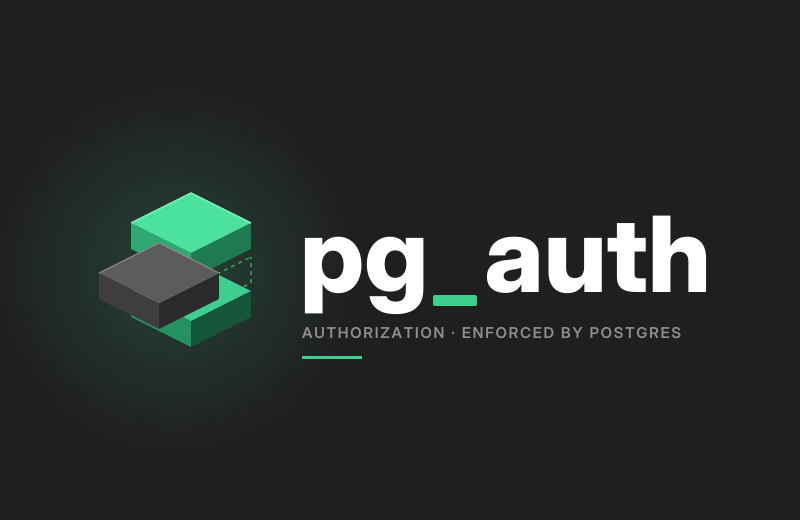

<p align="center"></p>

<p align="center"><b>Real authorization for Postgres-backed apps. No policies to write, no backend to run.</b></p>

pg_auth lets an authorization engine (OpenFGA, SpiceDB or Cerbos) decide who may see and change
each row, and has Postgres enforce that decision for every client: your browser app through
PostgREST or Supabase, an application server, psql. Sharing, teams, roles, inherited folders and
rules on a row's own fields live in one model. A table is protected with one call, and pg_auth
turns it into row level security that the planner can index.

**Docs:** https://filipecabaco.github.io/pg_auth/

## From policies to one line

The same app, shared documents in organisations, with hand-written RLS:

```sql
create function private.is_member(org uuid) returns boolean
language sql stable security definer set search_path = '' as $$
  select exists (select 1 from public.memberships m where m.org_id = org and m.user_id = (select auth.uid()))
$$;
create function private.is_shared(doc uuid) returns boolean
language sql stable security definer set search_path = '' as $$
  select exists (select 1 from public.shares s where s.document_id = doc and s.user_id = (select auth.uid()))
$$;
alter table documents enable row level security;
create policy read on documents for select to authenticated
  using ((select private.is_member(org_id)) or (select private.is_shared(id)));
create policy write on documents for update to authenticated
  using ((select private.is_member(org_id))) with check ((select private.is_member(org_id)));
-- ... and insert, delete, an index per membership table, and every other table that needs it
```

With pg_auth, the rules live in the engine's model, once, and each table names what it is:

```
type document                                   # OpenFGA model
  relations
    define org: [org]
    define viewer: [user] or member from org
    define editor: [user] or admin from org
```

```sql
select authz.protect('public.documents', type => 'document', id => 'id', read => 'viewer', write => 'editor');
```

Every client now sees exactly the documents the engine allows, and a change to the model, such as
a new role or a document shared, applies with no migration and no policy to edit.

## Ask why a row is hidden

RLS hides rows silently. pg_auth tells you why:

```sql
select * from authz.why('public.documents', '42', as_subject => 'user:anne');
```
```
 step               | ok | detail
--------------------+----+------------------------------------------------------------------
 subject            | t  | user:anne (pg_auth.as_subject: an administrator acting as this subject)
 row level security | t  | on, forced: the table owner is checked too
 row                | t  | id = 42 exists
 policy pg_auth     | f  | user:anne lacks document#viewer on document:42; writes need document#editor
 verdict            | f  | hidden from user:anne: no pg_auth policy allows it
```

`authz.doctor()` checks the setup and prints the statement that fixes each problem: a missing
index, a table RLS does not force, a table an API role can read with no RLS at all.
`authz.explain(sql)` shows how each protected table in a query will be checked.

## The RLS mistakes you cannot make

Each of these is a real problem people hit with RLS, reproduced as a benchmark scenario that checks
pg_auth's behaviour ([the catalogue](docs/research/rls-issues.md)):

- **Views that leak:** a view owned by the table owner skips RLS. pg_auth forces its policies on
  the owner by default, and the subject comes from the request, not the role running the query.
- **Policy recursion (`42P17`):** a policy cannot recurse, because pg_auth's policy reads only the
  row.
- **Partitions queried directly:** every partition, including ones created later, gets the policy.
- **`UPDATE` silently changing 0 rows** for lack of a `SELECT` policy: read and write permissions
  are installed together.
- **Leaky functions:** a user function never sees a row the subject may not read.
- **A spoofed identity:** the request's role cannot set its own subject (the setting is
  superuser-only), and with no subject there are no rows rather than an error.
- **Fails closed:** if the sidecar or the engine cannot answer, the query fails, so rows are never
  shown by mistake.

pg_auth shares RLS's limits where Postgres sets them: superusers and `BYPASSRLS` roles skip every
policy, and a `SECURITY DEFINER` function owned by one does too. An identity set for a whole
session, on a pooled connection that is never reset, outlives its request, so set it with
`SET LOCAL`.

## Engines

| engine | decides on | in Postgres |
|---|---|---|
| [OpenFGA](https://openfga.dev) | relationships (Zanzibar) | listed ids, batched checks, a permission index for broad subjects |
| [SpiceDB](https://authzed.com/spicedb) | relationships (Zanzibar) | the same, with SpiceDB's Watch as the change feed |
| [Cerbos](https://cerbos.dev) | a row's attributes and the user's roles | the rule compiled into an indexable SQL filter |

The extension speaks one protocol to a sidecar that runs next to Postgres, so the engine can be
changed without touching the database.

## Quick start

pg_auth is pre-release: build it from source. Postgres 15, 16, 17 and 18 are supported.

```sh
mise install                                   # the pinned toolchain (mise.toml)
cargo pgrx install --release --pg-config "$(which pg_config)"
```

```sql
-- postgresql.conf: shared_preload_libraries = 'pg_auth'
create extension pg_auth;
alter system set pg_auth.sidecar_socket = '/run/pg_auth/default.sock';
select pg_reload_conf();
select authz.configure(subject => 'jwt');      -- the JWT's sub, as Supabase and PostgREST set it
select authz.protect('public.documents', type => 'document', id => 'id', read => 'viewer', write => 'editor');
select * from authz.doctor();
```

Run the sidecar ([`sidecar/query`](sidecar/query/README.md)) next to Postgres, pointed at your
engine. [Getting started](docs/usage.md) covers the rest: subjects from signed tokens, several ways
to reach a row, inherited folders, attribute rules, inserts checked on the parent.

## Grant access by writing rows

An app with no backend grants and revokes access the way it writes anything else: a row, through
PostgREST. `authz.relate` declares a table's rows to be relationships in the engine, and pg_auth
delivers each change; who may write those rows is pg_auth too.

```sql
select authz.relate('public.memberships', object_type => 'org', object_column => 'org_id',
                    relation_column => 'role', subject_type => 'user', subject_column => 'user_id');
select authz.protect('public.memberships', type => 'org', id => 'org_id', read => 'can_read', write => 'can_manage');
```
```sql
insert into memberships values (1, 'bob', 'member');   -- as an org admin: bob sees org 1's documents ~25 ms later
```

Changes travel through an outbox written in the same transaction, so a rolled-back write never
reaches the engine, an engine outage only delays them, and a change the engine refuses is set aside
for `authz.doctor()` to report.

## Documentation

- [Getting started](docs/usage.md): install, subjects, protecting tables, granting by writing rows, debugging
- [Implementation](docs/design.md): the planner hook, AuthzBatch, the permission index, the protocol, security
- [Performance](docs/performance.md): what it costs, where it wins and loses, how to tune it
- [Benchmarks](docs/benchmarks.md): 35 scenarios against hand-tuned RLS
- [Testing](docs/testing.md): the test suites, parity against each engine, coverage
- [Development](docs/development.md): toolchain, lints, where `unsafe` lives, profiling

## License

Not yet chosen.
